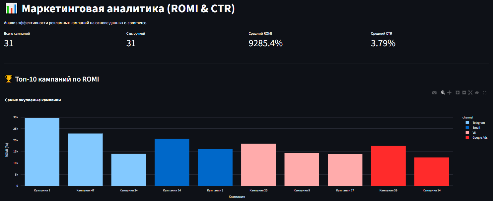
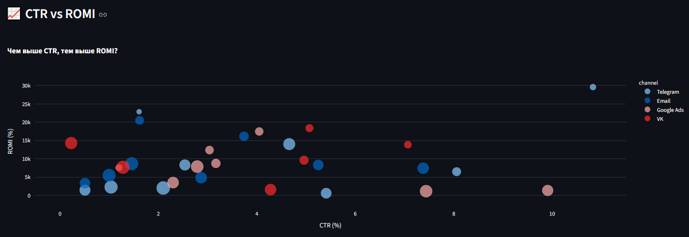
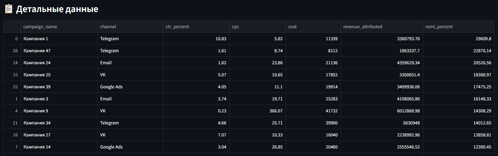
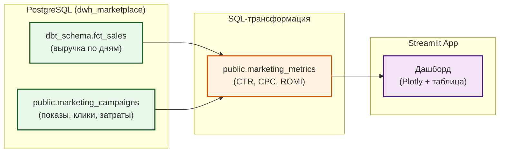

# 📊 Marketing Analytics Demo (ROMI & CTR)

Pet-проект: анализ эффективности рекламных кампаний на основе данных e-commerce. Демонстрирует навыки расчета ключевых маркетинговых метрик (CTR, CPC, ROMI) и визуализации данных.

## 📸 Скриншоты

**1. Общие метрики и Топ-10 кампаний по ROMI:**



**2. Зависимость CTR от ROMI:**



**3. Детальная таблица с показателями:**



## 🎯 Зачем это

В маркетинговой аналитике важно не просто посчитать клики, а понять, **какая кампания приносит деньги**. Этот проект показывает, как из сырых данных о показах, кликах и затратах получить **ROMI** (Return on Marketing Investment) и сравнить эффективность разных каналов (Telegram, VK, Email, Google Ads).

## 🏗 Архитектура



## 📂 Структура

```
marketing-analytics-demo/
├── sql/
│   ├── 01_init_campaigns.sql       # Генерация тестовых кампаний
│   └── 02_marketing_metrics.sql    # Расчет CTR, CPC, ROMI
├── app/
│   ├── __init__.py
│   └── streamlit_app.py            # Дашборд (Streamlit + Plotly)
├── assets/                         # Скриншоты для README
├── README.md
└── requirements.txt
```

## 🚀 Запуск

### 1. Инициализация данных
Выполни SQL-скрипты в PostgreSQL (база `dwh_marketplace`):
```sql
-- Создание таблицы кампаний
\i sql/01_init_campaigns.sql

-- Создание витрины с метриками
\i sql/02_marketing_metrics.sql
```

### 2. Запуск дашборда
```bash
pip install streamlit plotly pandas sqlalchemy psycopg2-binary
streamlit run app/streamlit_app.py
```

Дашборд будет доступен по адресу `http://localhost:8501`.

## 📈 Метрики (расшифровка)

| Метрика | Расшифровка (англ.) | Формула | Что показывает (по-русски) |
| :--- | :--- | :--- | :--- |
| **CTR** | Click-Through Rate | (Клики / Показы) * 100 | **Кликабельность.** Процент людей, которые кликнули на рекламу после того, как её увидели. |
| **CPC** | Cost Per Click | Затраты / Клики | **Стоимость клика.** Сколько денег ты платишь за один переход по рекламе. |
| **ROMI** | Return on Marketing Investment | (Выручка - Затраты) / Затраты * 100 | **Окупаемость рекламы.** Если ROMI > 0 — реклама принесла больше, чем потратили. Если < 0 — сработали в минус. |
| **AARRR** | Acquisition, Activation, Retention, Referral, Revenue | — | **Воронка продаж.** Путь клиента: как узнал -> зашел -> купил -> вернулся -> порекомендовал. |
| **LTV** | Lifetime Value | — | **Пожизненная ценность клиента.** Сколько денег приносит один клиент за все время работы с тобой. |
| **CAC** | Customer Acquisition Cost | — | **Стоимость привлечения клиента.** Сколько стоит заполучить одного нового клиента. (Если LTV > CAC — бизнес работает). |

## 📊 Результаты (пример)

- **Кампания 1 (Telegram):** ROMI = 29 609%, CTR = 10.83%, CPC = 5.82 руб.
- **Кампания 24 (Email):** ROMI = 20 526%, выручка = 4.3 млн.
- **Кампания 9 (VK):** ROMI = 14 308% (при очень низком CTR и высоком CPC).

## 🔗 Связанные проекты

- [`marketplace-dwh-analytics`](https://github.com/nconichtchenko-arch/marketplace-dwh-analytics) — источник данных (fct_sales).
- [`data-governance-platform`](https://github.com/nconichtchenko-arch/data-governance-platform) — управление данными.
- [`ecommerce-analytics-rfm`](https://github.com/nconichtchenko-arch/ecommerce-analytics-rfm) — RFM-анализ.

## 📫 Контакты

- **GitHub:** [github.com/nconichtchenko-arch](https://github.com/nconichtchenko-arch)
- **Email:** pavloni@mail.ru
- **Формат работы:** удалённо
